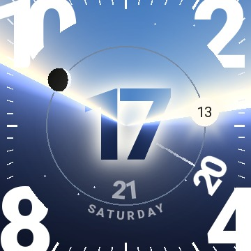

# Solar & Lunar Analog Clock for Unfolded Circle Remote 2 / Remote 3

An astronomical watch face integration for **Unfolded Circle Remote Two & Remote 3** rendering a real-time `360x360` dynamic sky dial with seasonal twilight gradients, an orbiting 24-hour Sun and true-phase Moon, live Open-Meteo weather (no API key required), and automatic collision avoidance.

## Screenshots

| Clear Day | Golden Sunset | Starry Night & Moon | Rainy Weather |
| :---: | :---: | :---: | :---: |
|  |  |  |  |

## Features
- **Seasonal Astronomical Sky:** Real-time civil, nautical, and astronomical twilight curves calculated for your latitude and day of year.
- **24-Hour Sun & True-Phase Moon Orbit:** Sun travels the 24-hour orbital ring (`12:00` top, `00:00` bottom) with current temperature inside; Moon tracks its real 29.53-day phase and solar conjunction corona.
- **Smart Horizon & Countdown Readouts:** Upcoming sunrise or sunset split across the orbital ring plus an inline countdown (`XhXX` / `Xm`) with proximity fading.
- **Live Weather Overlay:** Free Open-Meteo data (no API key required) for clouds, rain streaks, and `°C` / `°F` temperature.
- **Media Widget & Page Tile Ready:** Full `360x360` dial on Media Player widgets / Standby screen, plus clean digital clock and weather metadata on standard page tiles.

## Configuration Options
Configure during setup or via **Web Configurator -> Integrations -> Reconfigure**:
- **Latitude & Longitude** (defaults to `41.39, 2.16`)
- **Center Hour Format:** `24-Hour (0-23)` or `12-Hour (1-12)`
- **Temperature Unit:** `Celsius (°C)` or `Fahrenheit (°F)`
- **Toggles:** Show Moon, Show Temperature, Show Sunrise/Sunset & Countdown, Show Date & Weekday

## Installation

### Option A: Docker Compose (Recommended)
```bash
git clone https://github.com
cd uc-intg-solar-clock
docker compose up -d --build
```
Then open **Web Configurator -> Integrations -> Add new** and select **Solar & Lunar Analog Clock**.

### Option B: Direct Upload to Remote 2 / Remote 3
Download `uc-intg-solar-clock-1.1.0.tar.gz` from [Releases](../../releases) and upload it under **Web Configurator -> Integrations -> Install custom**.

## License
Mozilla Public License 2.0 (MPL-2.0)
