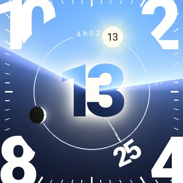
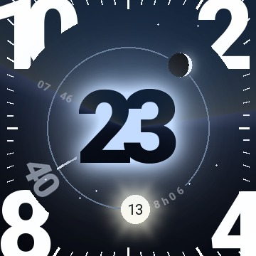
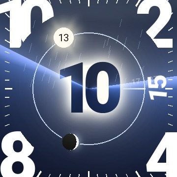

# Solar & Lunar Analog Clock for Unfolded Circle Remote 2 / Remote 3

An astronomical watch face integration for **Unfolded Circle Remote Two & Remote 3** rendering a real-time `360x360` dynamic sky dial with seasonal twilight gradients, an orbiting 24-hour Sun and true-phase Moon, live Open-Meteo weather (no API key required), and automatic text collision avoidance.

## Important: Use as a Media Player Widget
**Use this integration as a Media Player Widget inside an Activity for accurate representation and full display of the clock.**

- **Activity Media Player Widget (Recommended):** Displays the complete, uncropped `360x360` dial edge-to-edge.
- **Tip for Multi-Activity Setups:** Create your Clock Activity inside its own separate **Activity Group** (e.g., `Clock` or `Ambient`) with an empty On/Off sequence so launching the clock never powers off your TV, AVR, or other running activities.
- **Custom Activity Icon:** You can upload `docs/clear_day.png` as your Activity's custom icon in the Web Configurator so your page button shows a miniature preview of the watch face.
- **Note on Direct Page Entities:** Adding the entity directly onto a standard page grid forces Unfolded Circle's compact tile layout (which crops/shrinks the square dial with large borders). Because Remote 2/3 shares a single image stream across both views, the artwork is calibrated specifically for the full **Media Player Widget**.

## Screenshots

| Clear Day | Golden Sunset | Starry Night & Moon | Rainy Weather |
| :---: | :---: | :---: | :---: |
|  |  |  |  |

## Features
- **Seasonal Astronomical Sky:** Real-time civil, nautical, and astronomical twilight curves calculated for your exact latitude and day of year.
- **24-Hour Sun & True-Phase Moon Orbit:** The Sun travels the 24-hour orbital ring (`12:00` top, `00:00` bottom) with current temperature inside, while the Moon tracks its real 29.53-day lunar phase, Full Moon glow, and solar conjunction corona.
- **Smart Horizon & Countdown Readouts:** Shows only the upcoming sunrise or sunset split across the orbital ring, plus an inline countdown (`XhXX` / `Xm`) with smooth proximity fading so text never overlaps.
- **Live Weather Overlay:** Uses free Open-Meteo data (no API key required) to render clouds, rain streaks, and temperature in `°C` or `°F`.

## Configuration Options
Configure during setup or via **Web Configurator -> Integrations -> Reconfigure**:
- **City, Town, or Lat, Lon:** Automatic worldwide geocoding for exact local sunrise, sunset, twilight, and timezone.
- **Center Hour Format:** `24-Hour (0-23)` or `12-Hour (1-12)`.
- **Temperature Unit:** `Celsius (°C)` or `Fahrenheit (°F)`.
- **Layer Toggles:** Individually enable or disable the **Moon**, **Temperature**, **Sunrise/Sunset & Countdown**, and **Date & Weekday**.

## Installation

### Option A: Docker Compose (Recommended)
```bash
git clone https://://github.com.git
cd uc-intg-solar-clock
docker compose up -d --build
```
Then open **Web Configurator -> Integrations -> Add new** and select **Solar & Lunar Analog Clock**.

### Option B: Direct Upload to Remote 2 / Remote 3
Download `uc-intg-solar-clock-1.2.0.tar.gz` from [Releases](../../releases) and upload it under **Web Configurator -> Integrations -> Install custom**.

## License
Mozilla Public License 2.0 (MPL-2.0)
